# shiftgate design

shiftgate deploys a containerised service blue-green behind one shared
HAProxy per host. It is a single static Go binary with no daemon. You run it
by hand, or a CI job runs it over SSH with an image digest. This document
records the data shape, the deploy and rollback state machine, the design
consult that shaped them, and how the first adopter's existing setup maps
onto shiftgate.

## Data shape

| Data | Owner | Readers | Writers | Durability |
|---|---|---|---|---|
| `services.yaml` | operator | every command | the operator (by hand) | file in version control or config management |
| `<state_dir>/<svc>/state.json` | shiftgate | every command | deploy, rollback, recover | temp file, fsync, rename, fsync the directory |
| `<state_dir>/<svc>/swaps.log` | shiftgate | people, audit | deploy, rollback, recover | append-only JSON lines, fsync per line |
| `<state_dir>/host.lock`, `<svc>/lock` | shiftgate | — | every mutating command | `flock(2)`; the kernel releases it if the process dies |
| generated `haproxy.cfg` | shiftgate | HAProxy | `render`, and the post-commit sync | validated with `haproxy -c` before install |
| HAProxy runtime state (admin socket) | HAProxy | deploy, rollback, recover, status | deploy, rollback, recover | memory only; lost on reload |
| Containers `shiftgate-<svc>-<colour>` | Docker | every command | deploy, rollback | labelled `shiftgate.service`, `shiftgate.color`, `shiftgate.digest` |

`state.json` holds the **committed** deployment identity: `active`
(colour and digest), `previous`, `rollback_available`, `history` (promoted
digests, newest first, used by prune), `generation`, `last_swap_at`,
`last_op`, `last_result` and `last_error`. It also holds `pending`: the
journal of an operation that has not committed. `pending` records the
operation id, the operation, the phase (`starting` or `flipping`), the from
and to slots, and the start time. HAProxy reports what is actually being
routed, but it never says which digest that is, so shiftgate never infers a
digest from HAProxy.

Env files appear only as paths. They go to `docker run --env-file`, and
shiftgate never opens them.

## Deploy state machine

```mermaid
stateDiagram-v2
    [*] --> Locked: host lock (shared) + service lock (exclusive, no wait)
    Locked --> Refused: pending intent / no state but containers exist / backend missing in HAProxy
    Locked --> Starting: write intent (phase starting); invalidate rollback if the target slot is the previous colour
    Starting --> Aborted: pull / run fails
    Starting --> Health: container running
    Health --> Aborted: health timeout (HAProxy untouched, target stopped)
    Health --> Flipping: write intent (phase flipping)
    Flipping --> TargetUp: set target ready, read back until ready and UP
    TargetUp --> OldDraining: set old drain (lost reply → read back)
    Flipping --> Compensate: target not UP / socket error
    OldDraining --> Compensate: drain not applied
    Compensate --> Aborted: old proven serving, target proven in maintenance
    Compensate --> RecoveryRequired: either cannot be proven (exit 3, both containers kept)
    OldDraining --> Committed: write state (active=target, previous=old), clear intent
    Committed --> Done: audit log, refresh config file (validated, no reload), drain to 0 sessions or drain_timeout, old to maintenance, docker stop (kept)
    Aborted --> [*]: exit 1, old colour serving
    RecoveryRequired --> [*]: shiftgate recover <svc>
    Done --> [*]: exit 0
```

A rollback uses the same machine, with one difference: instead of pull and
run, it checks that the previous colour's container exists and carries the
recorded digest, and starts it if it is stopped. A rollback never pulls. If
the previous container is gone, shiftgate refuses.

`recover <svc>` resolves a pending intent:

- **`starting`:** routing was never touched, so recover stops the target
  container and clears the intent.
- **`flipping`:**
  - If the target is ready and UP, the old colour is no longer ready, and the
    target container is running with the intended digest, recover finishes
    the commit.
  - If the old colour is ready and UP, recover compensates back to it.
  - Otherwise it does nothing and exits 3 with the observed states, because
    only a person can decide.

Exit codes: 0 ok, 1 failed (old colour serving), 2 usage, 3 recovery
required, 75 locked, 78 configuration refused.

### Facts verified against real HAProxy (2.8.31 and 3.1.17)

| Situation | `srv_admin_state` |
|---|---|
| server rendered `disabled` | 5 (forced and config maintenance) |
| after `set server … state ready` | 4 (the informational config-maintenance bit stays set) |
| after `state drain` | 8 |
| after `state maint` | 1 |

Because of this, shiftgate counts a server as "ready" when it has no
forced, inherited, resolution or health maintenance bits and no drain bits,
and it ignores bit 0x04. `set server` answers nothing on success and
`No such server.` on error. `show stat <be> 4 -1` CSV has `scur`. The tests
pin these values: `TestParseRealServersStateAnswer`, and the fake socket
mirrors them.

## Design consult

Before writing any code, I asked one consultant from the other model family
(OpenAI `gpt-6.1-sol`, through `codex exec` in a read-only sandbox with no
MCP; operator-approved, because the pane spawn was blocked by an unrelated
gate). The consult got a self-contained packet with the proposed data shape,
the state machine and seven questions. It rated every answer
high-confidence.

| # | Consultant's answer (summary) | Decision |
|---|---|---|
| Q1 | State alone cannot resolve an interrupted flip. Keep committed state **plus a durable intent** (operation id, phase, from/to, references), written before any destructive or socket step, and reconcile under locks. Never infer digests from HAProxy. Publish container ports on loopback only, prohibit `run_args` that override managed flags, keep env files opaque, fsync the directory after rename, and treat the swap log as audit only. | **Adopted.** Changes: `pending` intent in `state.json` (container ids are not stored; the `shiftgate.digest` label is checked instead), ports published as `127.0.0.1:<colour>:<container>`, a `run_args` denylist that also catches clustered short flags, a directory fsync, and swap-log failures as warnings only. |
| Q2 | Render from committed state, and skip server-state files: they are another stale artifact, not a transaction. Use a host lock (shared for deploy, exclusive for render) so a reload never interleaves with a flip. Order: intent → socket changes and read-back → commit → drain. | **Adopted.** `render` takes the host lock exclusively and refuses while any service has a pending intent. After each commit, deploy also refreshes the generated file (validated, **not** reloaded), so an outside `systemctl reload` keeps the new colour. |
| Q3 | Set the target ready, verify it is operationally UP (`ready` changes only the admin state), then drain the old colour. Draining first risks having no server. Use one interactive session or semicolon batches; neither is atomic. | **Adopted, with one change.** Read-back polls `show servers state` until the target is ready and UP before the old colour is drained. **Not adopted:** one interactive session. Each command uses its own connection, because batching gives no atomicity and per-command errors are easier to attribute. |
| Q4 | Refuse when the previous container is absent; verify its identity before starting it. Rebuilding from a digest needs the old launch configuration, so it should be a separate, explicit feature. | **Adopted.** Rollback checks that the container exists, that `shiftgate.service` and `shiftgate.color` match, and that the `shiftgate.digest` label equals `previous.digest`. |
| Q5 | Two slots cannot represent "the last N", so keep a promotion history. Protect the active, previous, pending and draining images and anything a colour container uses. Never force-remove; serialise against pulls. | **Adopted.** `history` in state. Prune takes the host lock exclusively (no pull can interleave), protects active, previous, pending, both colour containers' digests and the newest `keep_digests` of history, and uses `docker image rm` without force. |
| Q6 | Step 1: missing state is a bootstrap only when no managed containers exist. Step 3: the target slot may be the previous colour, so mark rollback unavailable first. Step 5: never stop the target after an uncertain compensation; prove the old colour serves before disabling the target, otherwise keep both and keep the intent. Step 6: a failed commit write after routing changed means recovery is required. Step 7: a cleanup failure is not a promotion failure. | **All adopted.** These are the `Refused`, `Starting`, `Compensate → RecoveryRequired` and commit-failure (exit 3) paths. A drain or stop failure after commit is a warning with exit 0. |
| Q7 | A fake socket proves protocol use, not routing semantics. Add fault injection and real-HAProxy tests. | **Adopted, partly.** Fault-injection tests cover a lost drain reply, an uncertain compensation, a target that never comes UP, and crash-recovery in both directions. The Docker end-to-end test routes through a **real HAProxy in CI** (installed with apt) and asserts which version the frontend serves. Not covered, deferred: HTTP/2 and tunnel behaviour during drain, and process death between the two writes, which is approximated by writing the intent by hand. |

The full answer is kept outside the repository with the job records.

## First adopter mapping

The first real user is the `auto_trader` NCP deployment
([`scripts/deploy-ncp-pull.sh`](https://github.com/mgh3326/auto_trader/blob/main/scripts/deploy-ncp-pull.sh)
and `ops/ncp/haproxy/haproxy.cfg.tmpl`). Moving it to shiftgate is a
separate later change. This PR only makes sure the model can express that
deployment. [`examples/adopter-ncp.services.yaml`](../examples/adopter-ncp.services.yaml)
writes its HAProxy layout in shiftgate terms, with generic names and a
documentation address for the tailnet IP.
`TestAdopterLayoutRendersEquivalentProxies` checks the rendered proxies, and
`haproxy -c` validates the file in CI. It also passed locally on HAProxy 2.8
and 3.1.

| auto_trader behaviour | shiftgate | Status |
|---|---|---|
| One HAProxy for the whole host (`at-haproxy` container) | one generated `haproxy.cfg`; `haproxy.reload: ["docker","kill","-s","HUP","…"]` | covered |
| API frontends on `127.0.0.1:8000` **and** `<tailnet>:8000` (two `frontend` sections) | `binds: [127.0.0.1:8000, <tailnet>:8000]` gives one frontend with two `bind` lines (same listeners, same backend) | covered (equivalent) |
| MCP frontends on `127.0.0.1:8765` and `<tailnet>:8765` | same, for the `mcp` service | covered |
| Five fixed-profile MCP units: tailnet-only listener, backend `127.0.0.1:876x` | static services: `upstream: 127.0.0.1:876x`, `binds: [<tailnet>:876x]` | render covered; their **container lifecycle is a gap** (in-place recreate, not blue-green) |
| Render guard: refuse `0.0.0.0`, require the loopback and tailnet binds | `haproxy.allowed_binds: [127.0.0.1, <tailnet>]` refuses any other address at config load and at render; wildcard needs `--allow-wildcard-bind` | covered (stricter: an allowlist instead of a grep) |
| `option httpchk GET /healthz` / `/health`, `http-check expect status 200` | `health.http`, `health.expect_status` | covered |
| `default-server inter 5s fall 2 rise 1` | `check: {inter: 5s, fall: 2, rise: 1}` | covered |
| `timeout client/server/tunnel 1h`, `http-request 10s`, `connect 5s` | `haproxy.timeouts` | covered |
| `log stdout format raw local0`, `master-worker` | `haproxy.log`; `master-worker` is always rendered | covered |
| Colour ports API 8001/8002, MCP 8766/8767; app binds the colour port on loopback with `--network host` | `ports: {blue, green}`, `network: host`, `args: [... "--port", "{port}"]`, `env: {MCP_PORT: "{port}"}` | covered |
| `AUTO_TRADER_COLOR=<colour>` env | `env: {X: "{color}"}` | covered |
| `--env-file .env.runtime --env-file .env.secrets` | `env_files: [...]` (paths only) | covered |
| Reads MCP tokens **out of** the env files and passes them as `-e MCP_AUTH_TOKEN=…` | shiftgate never reads env files | **gap, by design**: the app should read its token variable from the env file directly |
| Per-unit `docker run` flags (`-v heartbeat dir`, approval-hash env) | `run_args` (volumes allowed), `env` | covered for blue-green services |
| Digest-pinned deploy (`IMAGE@sha256:…`), `deployed-digest` / `.previous` files | `deploy --digest`; `state.json` `active`/`previous`/`history` | covered |
| Health wait: 30 tries × 2 s on `/healthz` | `health: {timeout: 60s, interval: 2s}` | covered |
| Unhealthy new colour: `docker rm -f` it, keep routing | stop it (kept for logs), HAProxy untouched, exit 1 | covered |
| Swap by re-rendering the template and SIGHUP reload | runtime API `set server … state` with read-back; **no reload** | covered (changed on purpose) |
| `haproxy.cfg.previous` restored if the reload fails | `render` validates with `haproxy -c` before install and keeps `haproxy.cfg.previous`; deploys never reload | covered |
| Config file bind-mounted into the container: overwrite in place to keep the inode | `Install` keeps the inode of an existing file | covered |
| Wait for HAProxy routes after reload (`curl` loopback endpoints) | deploy reads back server state through the admin socket | covered (differently); `render` does not curl the frontends — **minor gap** |
| Delayed `docker rm` of the old colour after `API_DRAIN_SECONDS=120` / `MCP_DRAIN_SECONDS=3600` (detached sleeper) | `drain_timeout` per service: wait for 0 sessions (or the timeout), maintenance, `docker stop`; the container is **kept** for rollback | covered (blocking, not detached; a 1 h drain blocks the CLI — see advisories) |
| Admin socket for HAProxy in a container | `haproxy.socket` (host path) and `haproxy.socket_in_config` (path inside the container); the socket directory must be bind-mounted | covered; needs a volume on the HAProxy container — **migration step** |
| `--rollback`: re-promote `deployed-digest.previous` (pull again, run everything) | `rollback <svc>`: start the kept previous container (no pull), health check, flip | covered for blue-green services; rebuilding from a digest after the container is gone is a **gap** (refused by design, Q4) |
| Worker, scheduler and websocket singletons (`at-worker`, `at-scheduler`, `at-*-ws`), log-line health checks | — | **gap**: not HTTP/TCP, not behind HAProxy; stays in the adopter's script |
| Cross-component rollback (an MCP failure rolls the API back) | — | **gap**: each service is independent; orchestrating several services is the caller's job |
| Legacy single `at-api` container bootstrap | — | **gap**: one-time migration step (see README, "Migrating") |
| Prune old images | `prune` (keeps `keep_digests`) | covered (new) |
| Concurrent deploy protection | per-service `flock` | covered (new) |
| Swap log | `swaps.log` JSON lines | covered (new; auto_trader keeps only digest files) |

## Advisories and non-goals

- **Drain blocks the CLI.** A long `drain_timeout` (the adopter's MCP uses
  1 h) keeps the deploy process and the service lock until drain finishes.
  A detached drainer is possible later; it would need its own durable
  record.
- **HTTP/2, WebSocket and tunnel connections** stay on the draining colour
  until they close or `drain_timeout` passes. After that, `docker stop` cuts
  them. This is by design.
- **One host, no daemon.** shiftgate does not coordinate several hosts or
  several services as one release.
- **No reconstruction from a digest.** When the previous container is gone,
  rollback is refused; deploy the old digest explicitly instead.
